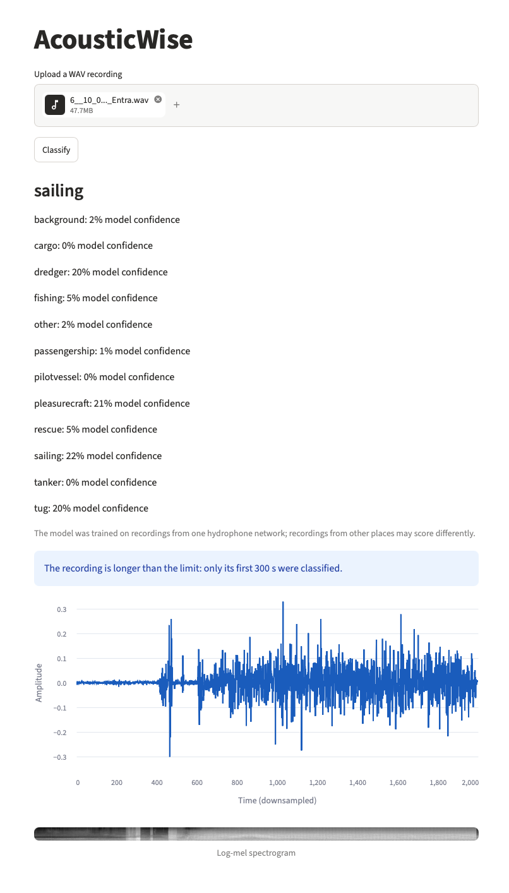
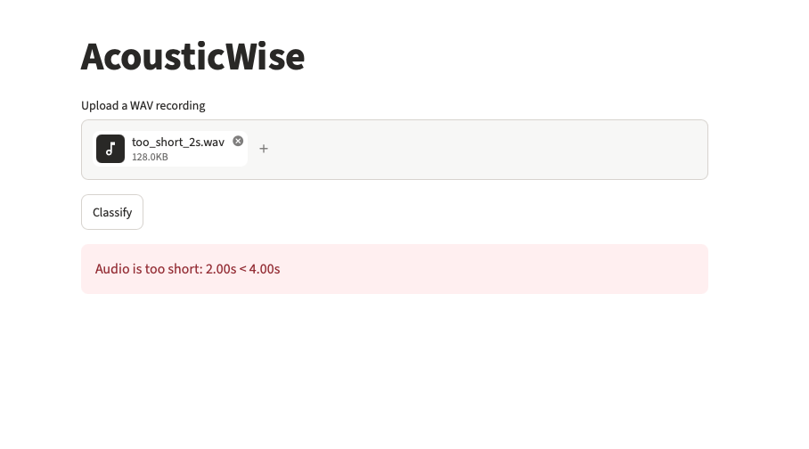
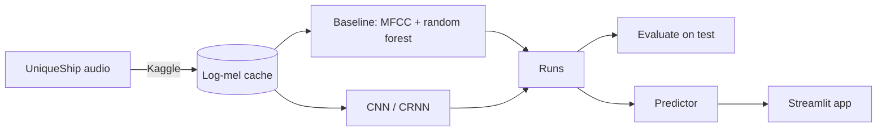

# AcousticWise

Classifies vessel type from underwater sound, on the [UniqueShip](https://uniqueshipdata.org/) dataset (12 classes). A log-mel CNN beats an MFCC baseline on vessels never seen in training, and runs in a local Streamlit app.



*A public ShipsEar sample: out-of-domain audio, not a validated result.*

## Run the app

```
git clone https://github.com/yanyetang/acousticwise.git && cd acousticwise
uv sync
curl -L -o artifacts/runs/r2-cnn/cnn_fold1_20261025-145517/model.pt \
  https://github.com/yanyetang/acousticwise/releases/download/v1.0/model.pt
uv run acousticwise-app
```

The model is the CNN trained on fold 1 (1 MB, SHA-256 `4b073b89…7bc54d`). Upload a WAV of at least 4 s; audio over 300 s is classified on its first 300 s. Set `ACOUSTICWISE_RUN_DIR` to serve another run.



## How it works



Splits are the dataset's five official folds, disjoint by vessel. Design: [`docs/technical-design.md`](docs/technical-design.md).

## Results

Test macro-F1, mean ± std over five folds. "9 classes" leaves out the three with 1 to 19 training vessels.

| Model | 9 classes | 12 classes | Accuracy |
|---|---|---|---|
| Random forest (MFCC) | 0.259 ± 0.045 | 0.218 ± 0.052 | 0.231 ± 0.073 |
| **CNN (log-mel)** | **0.322 ± 0.044** | **0.272 ± 0.053** | **0.275 ± 0.092** |
| CRNN (log-mel) | 0.315 ± 0.055 | 0.270 ± 0.070 | 0.273 ± 0.095 |

The CNN wins on all five folds; chance is about 0.11. Details: [`docs/results.md`](docs/results.md).

## Limitations

- One hydrophone network: it generalizes to unseen vessels at the same sites, not to other places or hardware.
- Dredger, pilotvessel and rescue have too few vessels to learn the type.
- Labels come from AIS, so clips can contain other sounds; `other` is a mixed class.

## Reproduce

- **Tier 1, no data:** `uv run pytest` (includes an end-to-end run on synthetic audio).
- **Tier 2, with data:** retraining matches the reported scores within ±1 point (baseline) and ±2 (CNN); checked in [`docs/results.md`](docs/results.md).

Data: download the bundle from [uniqueshipdata.org](https://uniqueshipdata.org/) (44 GB free needed: 18 GB zipped, 26 GB unzipped), or build the cache on Kaggle (technical design, section 12). Then:

```
uv run python scripts/cache_features.py      # skip if the cache came from Kaggle
uv run python scripts/build_manifest.py
uv run python -m acousticwise.train --fold 1 --model cnn
uv run python -m acousticwise.evaluate artifacts/runs/<run>
```

## Data and credits

Ocean Networks Canada hydrophone data via UniqueShip, CC-BY 4.0. Provenance, checksums and citation: [`DATA.md`](DATA.md).
