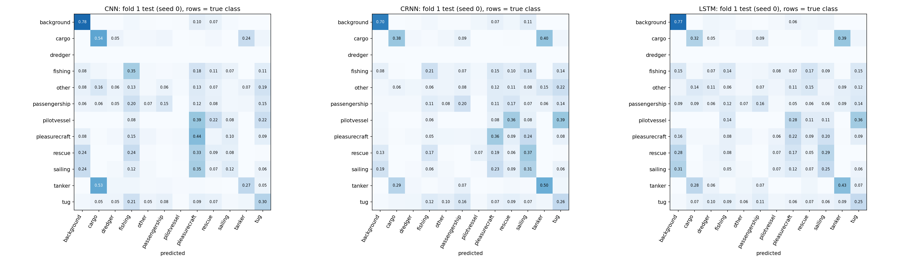
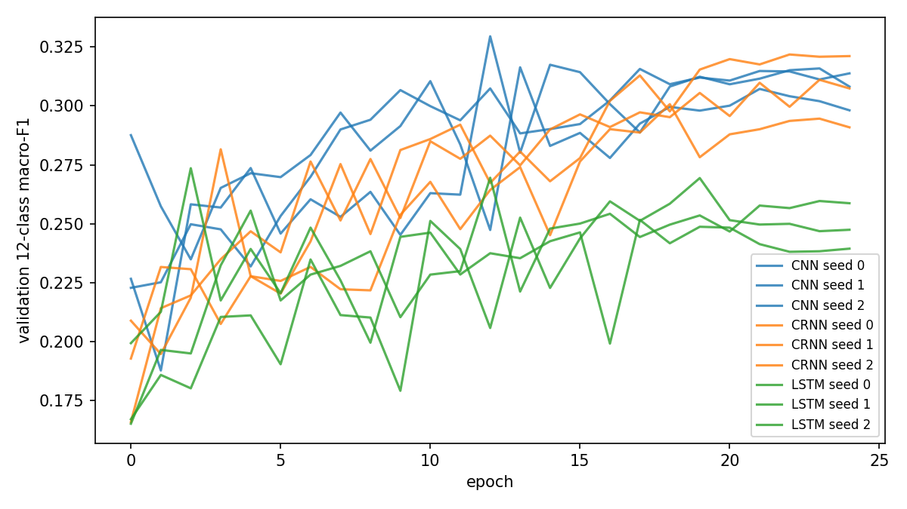

# Spike: CNN vs CRNN vs LSTM on fold 1 (preliminary)

Run on Kaggle (T4 GPU) on 2026-10-16 with notebook `spike_cnn_crnn_lstm.ipynb`. Raw outputs are in `results/`.

**These numbers are preliminary.** They come from one fold, a capped training set and 25 epochs. The real comparison runs on all 5 folds in S15.

New to machine learning? Read the [plain-language guide](#plain-language-guide) at the end first.

## Question

The CNN averages its features over time. Does a model that reads the clip as a sequence (an LSTM) classify vessel types better?

## Setup

| | |
|---|---|
| Data | UniqueShip 12-class, official fold 1, vessel-disjoint |
| Train | 7,200 clips (600 per class, spread round-robin over vessels or days) |
| Validation | 1,650 clips (up to 150 per class) |
| Test | 4,477 clips, the full fold 1 test split (no dredger, so 11 classes) |
| Input | 5 s log-mel, 32 kHz, 64 mels × 313 frames, standardized |
| Training | AdamW lr 1e-3, cosine decay, batch 64, 25 epochs, 3 seeds per model |
| Model choice | best epoch by validation 12-class macro-F1; test scored once |

The three models:

- **CNN** (242 k params): 4 conv blocks, then the mean over time.
- **CRNN** (341 k params): the same conv blocks, then a bidirectional LSTM over 78 time steps.
- **LSTM** (202 k params): a bidirectional LSTM directly on the 313 log-mel frames, with no conv layers.

## Results

Mean ± std over 3 seeds, on the fold 1 test split.

| Model | Macro-F1 (12-class) | Macro-F1 (9-class) | Accuracy | Train time / seed |
|---|---|---|---|---|
| CNN | 0.258 ± 0.006 | 0.303 ± 0.006 | 0.293 ± 0.005 | 185 s |
| **CRNN** | **0.265 ± 0.002** | **0.314 ± 0.005** | **0.298 ± 0.001** | 189 s |
| LSTM | 0.221 ± 0.021 | 0.263 ± 0.021 | 0.249 ± 0.022 | 61 s |

Random guessing over the 11 test classes would score about 0.09.

### Per-class F1 (mean of 3 seeds)

| Class | Test vessels / days | Test clips | CNN | CRNN | LSTM | CRNN − CNN |
|---|---|---|---|---|---|---|
| background | 82 days | 362 | 0.601 | 0.601 | 0.496 | 0.000 |
| cargo | 311 | 457 | 0.420 | 0.408 | 0.293 | −0.012 |
| tanker | 34 | 526 | 0.409 | 0.480 | 0.433 | **+0.071** |
| pleasurecraft | 50 | 445 | 0.294 | 0.299 | 0.254 | +0.005 |
| tug | 39 | 473 | 0.266 | 0.287 | 0.254 | +0.021 |
| fishing | 31 | 468 | 0.262 | 0.235 | 0.146 | −0.027 |
| sailing | 26 | 441 | 0.204 | 0.245 | 0.254 | **+0.041** |
| passengership | 13 | 432 | 0.211 | 0.221 | 0.180 | +0.010 |
| rescue | 3 | 412 | 0.109 | 0.085 | 0.057 | −0.024 |
| other | 20 | 425 | 0.064 | 0.049 | 0.060 | −0.015 |
| pilotvessel | 1 | 36 | 0.000 | 0.007 | 0.000 | +0.007 |

### Figures

## What it means

1. **The CRNN is slightly ahead of the CNN, but the gap is not yet proven.** On 12 classes the gap (+0.007) is about the size of the CNN's seed spread (0.006), and the seeds overlap: the best CNN seed (0.265) beats the worst CRNN seed (0.264). On 9 classes the gap (+0.011) is about twice the spread, which is suggestive but comes from only one fold. The CRNN is also more stable across seeds.
2. **The LSTM alone is clearly worse.** It scores about 0.04 below the CNN, well outside the seed spread, and it varies most between seeds (one seed peaked at epoch 3). Raw frames are a long sequence (313 steps) with no frequency-pattern learning. This supports putting conv layers in front of the LSTM rather than using the LSTM alone. It is about 3× faster to train.
3. **The CRNN may not have finished learning.** Its best epochs were 19, 23 and 24, while the CNN peaked at epochs 13–18 (see the validation curves). More epochs could help the CRNN more than the CNN.
4. **Where the CRNN helps:** tanker (+0.07) and sailing (+0.04) improve the most. The biggest error in every model is cargo vs tanker. Both are large merchant ships with similar engine sound.
5. **Some classes cannot be judged on this fold.** Pilotvessel has 1 test vessel (36 clips) and rescue has 3, so their F1 mostly reflects those few vessels.
6. **Validation scores (about 0.32) are higher than test (about 0.26).** New vessels in the test split are harder than the validation vessels. This is expected with vessel-disjoint splits.

## 5-class rescore (rerun, 2026-10-23)

The dataset paper reports 66.5% accuracy on 5 classes: background, cargo, passengership, tanker, tug. To put a comparable number beside it, the notebook was rerun on Kaggle with **the same training** and one addition: every test clip's 12 class scores (logits) are saved. Section 9 of the notebook then **rescores** the same models on the paper's 5 classes:

1. keep only the test clips whose true class is one of the 5 (2,250 of 4,477 clips);
2. from each clip's 12 scores, keep the 5 and predict the highest of those.

No model is retrained on 5 classes. Raw outputs are in `results/rescore/`, including `test_logits.npz`, so other class subsets can be rescored without retraining.

**The rerun reproduces the 12-class results** within the seed spread (GPU training is not bit-for-bit repeatable):

| Model | 12-class F1, Oct 16 | 12-class F1, rerun |
|---|---|---|
| CNN | 0.258 ± 0.006 | 0.261 ± 0.012 |
| CRNN | 0.265 ± 0.002 | 0.264 ± 0.002 |
| LSTM | 0.221 ± 0.021 | 0.221 ± 0.021 |

**5-class results**, mean ± std over 3 seeds, fold 1 test:

| Model | Accuracy | Balanced accuracy | Macro-F1 |
|---|---|---|---|
| CNN | 0.539 ± 0.015 | 0.559 ± 0.012 | 0.541 ± 0.024 |
| **CRNN** | **0.552 ± 0.018** | **0.568 ± 0.020** | **0.555 ± 0.019** |
| LSTM | 0.482 ± 0.017 | 0.498 ± 0.016 | 0.483 ± 0.019 |

Balanced accuracy is the mean of the 5 per-class recalls. The paper's 5-class data is balanced and our fold 1 test split is not, so it is the closer figure to set beside the paper.

**Per-class recall, CRNN, 3 seeds pooled** (rows: true class; columns: predicted):

| true \ predicted | background | cargo | passengership | tanker | tug |
|---|---|---|---|---|---|
| background | **0.91** | 0.00 | 0.05 | 0.00 | 0.04 |
| cargo | 0.00 | **0.48** | 0.10 | 0.34 | 0.08 |
| passengership | 0.16 | 0.07 | **0.38** | 0.08 | 0.32 |
| tanker | 0.00 | 0.41 | 0.07 | **0.42** | 0.11 |
| tug | 0.06 | 0.04 | 0.21 | 0.04 | **0.65** |

What it shows:

1. **About 0.55 accuracy on the paper's 5 classes**, against the paper's 0.665 (SwinV2-Tiny) and 0.617 (MobileNetV3-Small, its only CNN). The earlier figure of about 0.60 to 0.62, read by eye from the confusion matrix, was too high.
2. **Background is easy (about 0.9 recall); the ships are not.** Most errors are between two pairs: **cargo and tanker** (large merchant ships with similar engine sound) and **passengership and tug**.
3. **The model ranking is unchanged:** CRNN slightly ahead of the CNN, within about one seed spread, and the LSTM alone clearly behind.

**Not directly comparable to the paper.** The paper trains 5-class models, on its 5-class balanced bundle (213 h), with ImageNet-pretrained backbones, over 5 folds. These are 12-class models trained from scratch on 600 clips per class, rescored on fold 1 only. The open questions are how much more data helps (full-data spike) and how much pretraining helps (pretrained MobileNetV3 spike).

## Full data (rerun, 2026-10-24)

Does more data help? Notebook `notebooks/spike_full/spike_full_data.ipynb` is a copy of the spike that uses **all fold 1 training and validation clips**, with a class-weighted loss. Everything else is the same: models, epochs, seeds, features and the fold 1 test split. Raw outputs are in `notebooks/spike_full/results/`.

| | Capped (rescore rerun) | Full data |
|---|---|---|
| Training clips | 7,200 (600 per class) | 34,286 (4.8×) |
| Validation clips | 1,650 | 4,445 |
| Train time per seed (CNN) | about 3 min | about 13 min |

**The class weights turned out to be close to 1** (0.8 to 1.5; pilotvessel 0.8, dredger 1.5, all others 0.97 to 1.0). The bundle has about 5 hours of clips per class, so the full training split is already nearly balanced in clips; it is the number of **vessels** per class that is unbalanced. In practice this run changes the amount of data, not the loss.

Mean ± std over 3 seeds, fold 1 test:

| Model | 12-class F1, capped → full | 9-class F1, capped → full | 5-class accuracy, capped → full |
|---|---|---|---|
| CNN | 0.261 → **0.271** (+0.010) | 0.308 → **0.325** (+0.017) | 0.539 → **0.572** (+0.033) |
| CRNN | 0.264 → 0.260 (−0.004) | 0.315 → 0.315 (0.000) | 0.552 → 0.543 (−0.009) |
| LSTM | 0.221 → 0.241 (+0.020) | 0.263 → 0.289 (+0.026) | 0.482 → 0.489 (+0.007) |

Full-data spreads are small (CNN 12-class ± 0.007, 5-class accuracy ± 0.018). Full-data 5-class balanced accuracy: CNN 0.591 ± 0.017, CRNN 0.557 ± 0.010, LSTM 0.503 ± 0.016.

**5-class recall, CNN on full data, 3 seeds pooled** (rows: true class):

| true \ predicted | background | cargo | passengership | tanker | tug |
|---|---|---|---|---|---|
| background | **0.93** | 0.00 | 0.05 | 0.00 | 0.02 |
| cargo | 0.00 | **0.58** | 0.09 | 0.26 | 0.07 |
| passengership | 0.13 | 0.05 | **0.49** | 0.05 | 0.28 |
| tanker | 0.00 | 0.45 | 0.07 | **0.40** | 0.08 |
| tug | 0.06 | 0.08 | 0.25 | 0.04 | **0.57** |

What it shows:

1. **4.8× more data gives only small gains.** The CNN gains about 1 point of 12-class F1 and 3 points of 5-class accuracy; the CRNN gains nothing. Data quantity is not the main limit.
2. **The limit is likely vessel variety, not clip count.** The extra clips mostly come from the same vessels: cargo already had about one clip per ship, while classes like passengership (88 training vessels) or pilotvessel (1) gain more clips of ships the model has already heard.
3. **The CNN now leads the CRNN.** The CRNN's small capped-data lead (about one seed spread) has reversed. Together with the spike, there is no evidence yet that reading the time order helps.
4. **The same confusions remain:** cargo vs tanker, and passengership vs tug.
5. **5-class accuracy is about 0.57 (balanced 0.59),** against the paper's 0.617 for MobileNetV3-Small and 0.665 for Swin. Pretraining (the MobileNetV3 spike) is the remaining big difference to test.

## Limits

- One fold out of 5; fold-to-fold differences are likely larger than seed differences.
- Training capped at 600 clips per class and 25 epochs; no augmentation and no tuning.
- Absolute scores are low and are not v1.0 numbers.
- The LSTM-only model is a standard, untuned version (final state only, no gradient clipping). Tuning might narrow its gap, though probably not close it.
- Audio is limited to 16 kHz by the dataset's 32 kHz sample rate; any ship sound above 16 kHz is not available to the models.

## Next steps

- Keep the CRNN in S14 as a config option next to the CNN (mean pool or bi-LSTM).
- In S15, compare baseline, CNN and CRNN on all 5 folds. Count a CRNN gain only if it is larger than the fold-to-fold spread.
- Consider training the CRNN longer (for example 40 epochs) and check if it keeps improving.
- Drop the LSTM-only model from v1.0.

## Plain-language guide

### The task

Each example is a 5-second recording from an underwater microphone, labeled with what was nearby: a ship type or background (no ship). There are 12 labels, called **classes**. A **model** learns to guess the class of a new recording from many labeled examples. This is **supervised learning**: every training example comes with the right answer.

### Train, validation and test

- **Train** (7,200 clips): the model learns from these.
- **Validation** (1,650 clips): checked after each pass to choose the best version of the model.
- **Test** (4,477 clips): the final exam, used once.

A ship in the test set never appears in training (**vessel-disjoint**). Otherwise a model could memorize individual ships instead of learning what a ship type sounds like.

### Sound as a picture

Each clip becomes a **log-mel spectrogram**: left to right is time (313 steps), bottom to top is pitch (64 bands), and brightness is loudness. The recordings are sampled at 32 kHz (32,000 measurements per second), so they hold sound up to 16 kHz, half the sample rate. Higher sounds are not in the data.

### The three models

| Model | How it reads the picture |
|---|---|
| CNN | scans small windows for patterns (such as an engine hum at a certain pitch), then averages them over time |
| LSTM | reads the picture one time step after another, with a memory of what came before ("long short-term memory") |
| CRNN | CNN pattern-finding first, then an LSTM reads those patterns in order |

### How training works

A model is a large set of numbers called **weights** (about 242,000 for the CNN). They start random and are adjusted step by step:

1. **Guess** the class for a **batch** of 64 clips.
2. **Measure the mistake** as one number, the **loss**.
3. **Work out** which way to nudge each weight to lower the loss (**backpropagation**).
4. **Nudge** every weight a little (**gradient descent**). The size of the nudge is the **learning rate**.

One **epoch** is one pass through all 7,200 training clips, about 113 batches. 25 epochs is about 2,800 learning steps. After each epoch the model is scored on validation, and the best epoch is kept.

The recipe line "AdamW lr 1e-3, cosine decay, batch 64, 25 epochs" means: use the **AdamW** optimizer (it adapts the step size per weight and keeps weights small), start with a learning rate of 0.001, shrink it smoothly to zero (**cosine decay**), learn from 64 clips at a time, and pass through the data 25 times. All three models used the same recipe, so only the architecture differs.

### Seeds and the ± numbers

Training has random parts: the starting weights, the shuffle order and dropout. A **seed** is the number that fixes those random choices. The same seed repeats a run exactly, and a different seed gives a different random start. Each model was trained with seeds 0, 1 and 2, so 3 runs.

The **±** is how much the 3 runs differed (standard deviation). If one model beats another by less than the ±, the win may be luck. For example, CRNN vs CNN is +0.007 against a spread of about 0.006, so it is not yet proven. LSTM vs CNN is −0.037, and even the best LSTM run (0.239) is below the worst CNN run (0.253), so that gap is real.

### The scores

- **F1** scores one class from 0 to 1. It combines "when the model said tug, was it a tug?" with "of all the tugs, how many did it find?"
- **Macro-F1** averages F1 over the classes, each class counting equally, so rare classes matter as much as common ones. **Accuracy** (the share of correct guesses) can look good while rare classes are ignored.
- **12-class** uses all classes; **9-class** leaves out rescue, dredger and pilotvessel, which have very few ships.
- Random guessing would score about 0.09.

### How to read the figures

**Confusion matrix** (`confusion.png`): rows are the true class, columns are the guess, and each row adds up to 1.0. The diagonal is correct guesses; anything else is a mix-up. For example, in the CNN panel, the tanker row shows 0.53 under cargo: 53% of tankers were called cargo. A dark vertical stripe shows a model's "default" guess when unsure (pleasurecraft for the CNN, sailing for the CRNN).

**Validation curves** (`val_curves.png`): the validation macro-F1 after each epoch for every run. Rising lines mean the model is still learning; the CRNN lines are still rising at epoch 25.

### Why the LSTM alone does worse (likely reasons, not tested)

1. It has no built-in way to find a pattern at a slightly different pitch, which the CNN's sliding windows do naturally.
2. Remembering across 313 steps is hard; the CRNN's LSTM reads only 78 steps of patterns the CNN already found.
3. Ship sound is mostly steady over 5 seconds, so the order in time adds little.
4. It was the least stable to train, and it was not tuned.

It trains about 3× faster, but training takes minutes either way, and the app only makes predictions, which take milliseconds for any of the three.

### What comes next: the baseline

The full comparison (S15) adds an **MFCC baseline**: a simple, classical method to compare against. MFCC boils each clip down to 40 hand-designed numbers (**features**), which go into a **random forest** (many decision trees voting) or an **SVM** (the widest boundary between classes), whichever scores better on validation. The question it answers: does a model that learns its own features from the full picture beat expert hand-designed features?
